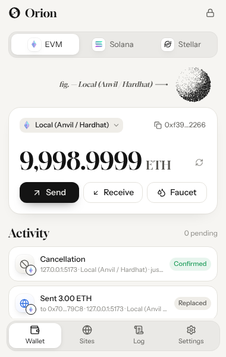
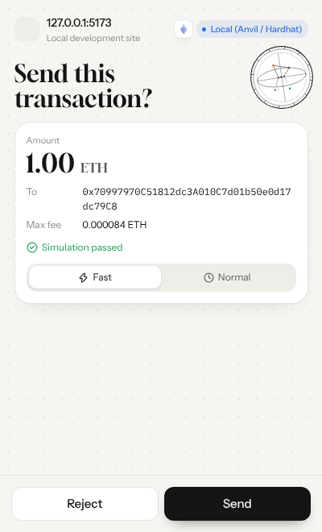
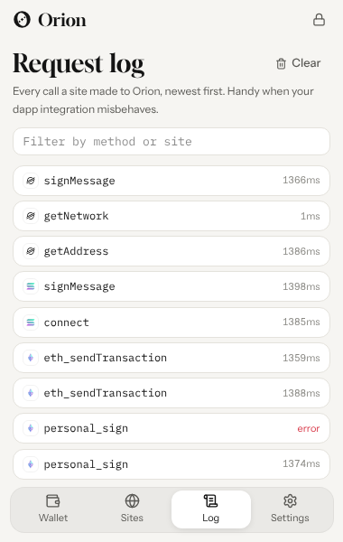

<picture>
  <source media="(prefers-color-scheme: dark)" srcset="public/orion-logo-light.svg">
  
</picture>

### The wallet for every chain you build on.

A browser-extension wallet for developers: one recovery phrase for **Ethereum & EVM chains**, **Solana** and **Stellar**, 
dapp sync on every chain, fast sends, and real cancel / speed-up where the chain allows it.

[Documentation](#documentation) · [Install](#install) · [Integrate](#integrate-with-your-dapp) · [How it works](#how-it-works) · [Contributing](#development)

 

---

> [!WARNING]
> **v0.1, testnet-first.** Orion has not been security-audited. Mainnets are hidden by default. Please don't keep real funds in it yet.

## Why Orion

Building across chains usually means juggling MetaMask for EVM, Phantom for Solana and Freighter for Stellar, three sets of testnet faucets, and no way to undo a stuck transaction. Orion puts all of that in one extension designed around how developers actually work:

- **One phrase, three families.** Standard derivation paths, so importing your phrase shows the same accounts as MetaMask, Phantom and Freighter.
- **Speaks every dapp's language.** EIP-6963 for EVM, the Wallet Standard for Solana, and SEP-43 for Stellar. Orion sits alongside your other wallets instead of fighting them.
- **Fast by default, reversible where possible.** Priority fees tuned per chain, real cancel and speed-up on EVM and Stellar, and an honest expiry countdown on Solana.
- **Built for testnets and local nodes.** Anvil / Hardhat, solana-test-validator and Stellar Quickstart are one click away, with faucets built in.
- **Tells you the truth.** Transactions are simulated before you sign, every dapp request is logged, and unreachable nodes are reported instead of hidden behind fake balances.

&nbsp;&nbsp;
&nbsp;&nbsp;

 
Wallet on a local Hardhat chain · a pending dapp payment with Speed up and Cancel · the cancel wins, the original is replaced

## Features

### Chains

| | EVM | Solana | Stellar |
|---|---|---|---|
| **Networks** | Sepolia, Base Sepolia, Arbitrum Sepolia, OP Sepolia, Anvil / Hardhat, custom chains · Ethereum & Base (opt-in) | Devnet, Testnet, solana-test-validator · Mainnet (opt-in) | Testnet, Quickstart · Public (opt-in) |
| **Dapp standard** | EIP-1193 via EIP-6963 | Wallet Standard | SEP-43, SEP-53 messages |
| **Derivation** | `m/44'/60'/0'/0/0` (BIP-32) | `m/44'/501'/0'/0'` (SLIP-10) | `m/44'/148'/0'` (SEP-5) |
| **Faucet** | `anvil_setBalance` / `hardhat_setBalance`, testnet links | Airdrop | Friendbot |

### Fast sends, cancel and speed-up

| Chain | Fast send | Speed up | Cancel |
|---|---|---|---|
| **EVM** | 2× suggested priority fee | Same nonce, fees +12.5% or current fast fee | 0-value self-transfer on the same nonce |
| **Stellar** | p90 fee, 30-second time bound | Fee-bump transaction at 10× (stellar-core's replace-by-fee rule) | Same-sequence no-op `bumpSequence` at 10× |
| **Solana** | p75 priority fee, rebroadcast every 2.5 s | Not safely possible | Not possible: Orion shows the blockhash-expiry countdown, after which it can never land |

### Developer tools

- **Request log**: every call a dapp made, with params, result, errors and timing.
- **Simulation before signing**: EVM transactions run through `eth_estimateGas`. Reverts, unlimited ERC-20 approvals and `setApprovalForAll` are flagged in the approval window.
- **Custom chains**: dapps can add and switch EVM chains with `wallet_addEthereumChain` / `wallet_switchEthereumChain`.
- **Clear approvals**: every request shows the site, network and a plain-language summary of what you're signing.

&nbsp;&nbsp;
&nbsp;&nbsp;

