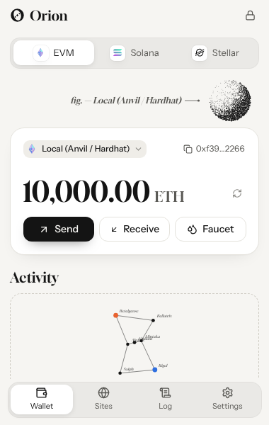

<picture>
  <source media="(prefers-color-scheme: dark)" srcset="public/orion-logo-light.svg">
  
</picture>

### The wallet for every chain you build on.

A browser-extension wallet for developers: one recovery phrase for **Ethereum & EVM chains**, **Solana** and **Stellar**, 
dapp sync on every chain, fast sends, and real cancel / speed-up where the chain allows it.

[Documentation](#documentation) · [Install](#install) · [Integrate](#integrate-with-your-dapp) · [How it works](#how-it-works) · [Contributing](#development)

 

---

> [!WARNING]
> **v0.1, testnet-first.** Orion has not been security-audited. Mainnets are hidden by default. Please don't keep real funds in it yet.

## Why Orion

Building across chains usually means juggling MetaMask for EVM, Phantom for Solana and Freighter for Stellar, three sets of testnet faucets, and no way to undo a stuck transaction. Orion puts all of that in one extension designed around how developers actually work:

- **One phrase, three families.** Standard derivation paths, so importing your phrase shows the same accounts as MetaMask, Phantom and Freighter.
- **Speaks every dapp's language.** EIP-6963 for EVM, the Wallet Standard for Solana, and SEP-43 for Stellar. Orion sits alongside your other wallets instead of fighting them.
- **Fast by default, reversible where possible.** Priority fees tuned per chain, real cancel and speed-up on EVM and Stellar, and an honest expiry countdown on Solana.
- **Built for testnets and local nodes.** Anvil / Hardhat, solana-test-validator and Stellar Quickstart are one click away, with faucets built in.
- **Tells you the truth.** Transactions are simulated before you sign, every dapp request is logged, and unreachable nodes are reported instead of hidden behind fake balances.

&nbsp;&nbsp;
&nbsp;&nbsp;

 
Wallet on a local Hardhat chain · a pending dapp payment with Speed up and Cancel · the cancel wins, the original is replaced

