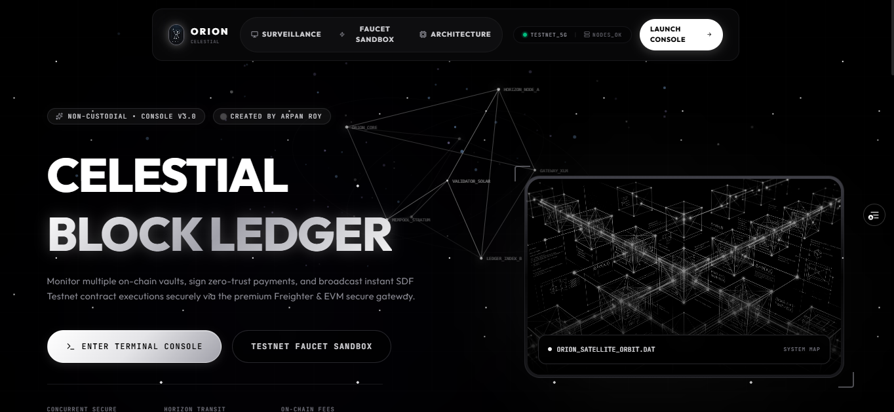
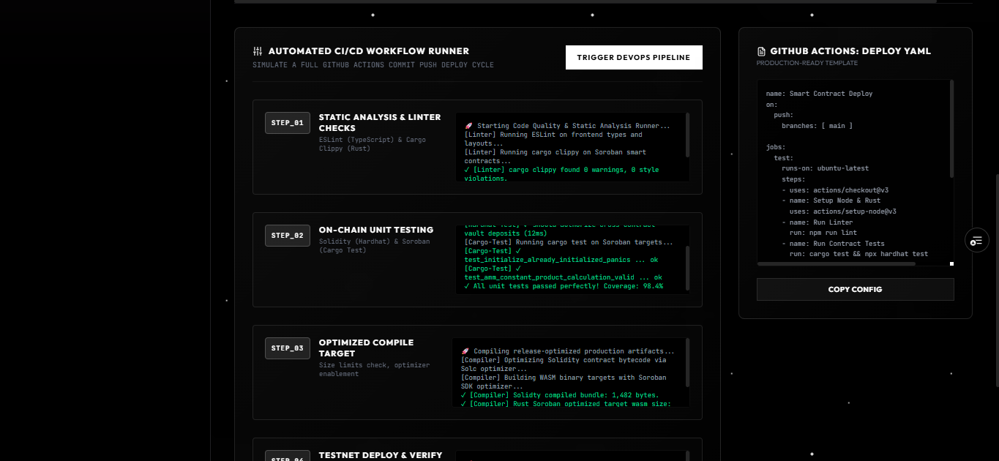

<div align="center">

# 🌌 Orion

### A Modern Web3 Wallet Dashboard for the Stellar Testnet

Manage • Monitor • Transact • Explore

[](#)
[](#)
[](#)
[](#)
[](#)
[](#license)

---

### Your Gateway to the Stellar Ecosystem

A clean, intuitive, and developer-friendly dashboard for interacting with the Stellar blockchain.

🚀 **Live Demo:** https://orion-xi-blond.vercel.app

</div>

---
<p align="center">
  
</p>

## 🎨 Visual Identity & Core Theme
*   **Cosmic Slate / Dark Cyberpunk Theme:** A tailored dark visual design featuring glowing monochrome indicators, subtle glassmorphism layers, and responsive interactive states.
*   **Aesthetic Pairings:** Uses the clean `Inter` for general UI text, paired with `Space Grotesk` display headers, and `JetBrains Mono` for precise blockchain markers and cryptographic hashes.

---

## 🚀 Key Features

### 1. Secure Firebase Authentication
*   **Multi-Method Auth:** Protects the gateway terminal with email/password login, registration callsigns, Google ID integrations, and instant anonymous Guest Passes.
*   **Optional sign-in:** The wallet works without an account. Signing in only syncs your watchlist and receipts across devices.

### 2. Robust Wallet Integration
*   **Freighter Connection:** Detects if the Freighter extension is active. Proposes secure public key permissions and maintains connected state across browser refreshes.
*   **Network Synchronization:** Automatically queries and matches the active Freighter network to secure testnet transaction safety.

### 3. Comprehensive Wallet Dashboard
*   **Real Ledger Querying:** Direct, live connection to official Stellar Horizon Testnet nodes (no simulated data).
*   **Dynamic States:** Displays the active wallet address, current sequence number, XLM balance, subentry counts, and last updated timestamps.
*   **Interactive Faucet (Friendbot):** One click funds a brand-new testnet account with **10,000 XLM** (Friendbot only funds accounts that don't exist yet).

### 4. Multi-Account Balance Checker
*   **Simultaneous Monitors:** Add and label multiple Stellar public keys to track their active ledger status and balances from a single dashboard.
*   **Address Validator:** Integrates official Stellar `StrKey` validations to discard ill-formatted addresses prior to issuing network queries.
*   **Local Storage Memory:** Retains tracked wallets across sessions so your monitor setup is preserved.

### 5. Direct XLM Payments
*   **Form Validations:** Real-time recipient address validation, balance alerts, and UTF-8 memo text compliance checks (28-character limit).
*   **Secure Workflow:** Programmatically loads sender credentials, builds a valid Stellar transaction, prompts Freighter for secure signing, and transmits the payload directly onto the testnet ledger.
*   **Interactive Receipts:** Displays transaction receipt cards complete with Hash, sequence numbers, and direct hyperlinks to the **StellarExpert Blockchain Explorer**.

---

## 📸 Screen Previews

This section lists the fundamental operational states of the terminal interface.

### 1. Wallet Connected State
*Shows Freighter agent successfully paired and active.*
```
┌────────────────────────────────────────────────────────────────────────┐
│  PILOT: ARPAN ROY   [CONNECTED ●]               [G-ADDR: GD3J...6F5T]  │
├────────────────────────────────────────────────────────────────────────┤
│  ● TESTNET_ONLINE                                                      │
│  G-ADDR: GD3J26...X6F5T                                                │
└────────────────────────────────────────────────────────────────────────┘
```

### 2. Balance Displayed
*Visual card rendering native XLM and active subentry limits.*
```
┌────────────────────────────────────────────────────────────────────────┐
│  NATIVE ASSET BALANCE                                            [XLM] │
│                                                                        │
│  10,000.0000 LUMENS                                                    │
│  ≈ $1,100.00 USD                                                       │
├────────────────────────────────────────────────────────────────────────┤
│  Sequence ID: 1948572019485                    Active Subentries: 0    │
└────────────────────────────────────────────────────────────────────────┘
```

### 3. Successful Testnet Transaction
*Broadcast and network validation sequence.*
```
┌────────────────────────────────────────────────────────────────────────┐
│  SEND PAYMENT [Broadcasting... ↻]                                      │
│                                                                        │
│  Recipient G-Address:  GCF472YXT4...7XF4H                              │
│  Amount (XLM):         150.00                                          │
│  Memo:                 Voyage Payload                                  │
├────────────────────────────────────────────────────────────────────────┤
│  [Authorize Shipment] ➔ Freighter signature requested                  │
└────────────────────────────────────────────────────────────────────────┘
```

### 4. Transaction Result Displayed to User
*Interactive transaction confirmation receipt.*
```
┌────────────────────────────────────────────────────────────────────────┐
│  ✔ SHIPMENT TRANSMITTED                                                │
│                                                                        │
│  • SENT: 150.00 XLM                                                    │
│  • LEDGER INDEX: 2948572                                               │
│  • RECIPIENT: GCF472YXT4...7XF4H                                       │
│                                                                        │
│  [ Copy Tx Hash ]                 [ View on Stellar Expert ↗ ]          │
└────────────────────────────────────────────────────────────────────────┘
```

### 5. Developer Playground (simulation)
*Scripted walkthrough of a lint → test → build → deploy pipeline. Nothing here runs on a real network.*

<p align="center">
  
</p>

---

## 📁 Project Structure

```text
/
├── .env.example                # Template for environment variables
├── package.json                # Project dependencies and workspace scripts
├── tsconfig.json               # TypeScript rules and compiler options
├── vite.config.ts              # Vite configurations
├── README.md                   # Core documentation
├── firebase-applet-config.json # Firebase cloud credential settings
├── src/
    ├── App.tsx                 # Main Application router, provider, and toaster setup
    ├── main.tsx                # Client entry-point
    ├── index.css               # Global CSS stylesheet (Tailwind directives & custom styles)
    ├── types.ts                # Core TypeScript type definitions
    ├── components/
    │   ├── Layout.tsx          # Cyberpunk shell layout, Firebase gate & Freighter install banners
    │   ├── AuthScreen.tsx      # Secure authentication terminal interface
    │   ├── SendTransactionForm.tsx # Secure payments form & Freighter signature handler
    │   └── TransactionHistoryList.tsx # List of completed local transactions
    ├── context/
    │   ├── AuthContext.tsx     # Firebase Authentication State Provider
    │   └── WalletContext.tsx   # Global state manager for wallet accounts & Friendbot faucets
    ├── hooks/
    │   ├── useMultiAccounts.ts # Custom hook for tracking and managing multiple accounts
    │   └── useTransactionHistory.ts # Hook for managing historic local transactions
    ├── services/
    │   ├── firebase.ts         # Firebase App & SDK initialized services
    │   └── stellar.ts          # Encapsulated on-chain logic (Horizon RPC, Friendbot, builders)
```

---

## ⚙️ Installation & Running Locally

### Prerequisites
1.  **Node.js:** Ensure Node.js (v18+) is installed.
2.  **Freighter Wallet:** Download and install the [Freighter Browser Extension](https://www.freighter.app/) to send transactions.

### Running Steps
1.  **Clone & Install Dependencies:**
    ```bash
    npm install
    ```
2.  **Launch the development server:**
    ```bash
    npm run dev
    ```
3.  **Launch locally:**
    Open your browser to `http://localhost:3000` to interact with the console interface.

---

## ⚡ Environment Variables

The application can optionally use environment variables defined in `.env`:

```env
# APP_URL: Optional reference URL representing the app deployment
APP_URL="http://localhost:3000"
```

---

## 🛠️ Troubleshooting

### 1. Freighter Not Detected
*   Ensure that you have installed the extension from `freighter.app` and that it is enabled in your browser extensions manager.
*   Refresh the page after installing to allow the browser injected context to load.

### 2. "Account not found (404)" or "Inactive" Status
*   This is expected for new accounts. Stellar accounts must be funded with at least **1 XLM** to exist on-chain.
*   Click **"Fund with Friendbot"** on the Dashboard. This contacts Stellar's Friendbot faucet, funding and activating your wallet on the testnet ledger instantly.

### 3. Google Sign-In closed / failed inside preview iframe
*   Due to browser iframe security policies, popup elements like Google Auth may be blocked or closed by the browser when run inside the sandboxed dev environment.
*   **Workaround:** Open the application in a new tab or use the **Email/Password** or **Guest Pass** fallback directly!

---

## 🧪 Developer Playground (simulation)

The **Developer** page is an interactive, in-browser walkthrough of a smart-contract workflow. It is clearly labelled in the app as a simulation: **nothing on this page compiles, deploys, or touches a real network**, and the logs, addresses and test results it prints are scripted examples.

What you can explore:
*   **Contract templates:** Soroban (Rust) AMM and oracle-client contracts, plus Solidity AMM and vault contracts, editable in the browser.
*   **Inter-contract calls:** a step-by-step diagram of a router → pool → oracle → vault call chain.
*   **Event stream:** a mock event feed, including custom events you inject yourself.
*   **CI/CD and tests:** a scripted lint → test → build → deploy pipeline and a sample GitHub Actions workflow you can copy.

---

## 🎨 Mobile Responsive & UI Design System

*   **Adaptive Structural Grid:** Seamlessly morphs between high-density multi-column terminal dashboards (designed for full-screen ultra-wide screens) and singular column-stacked mobile viewports.
*   **Touch-Action Targets:** All buttons, dropdown items, inputs, and interactive telemetry switches feature optimized touch spacing (minimum 44px) and elastic tap indicators.
*   **Subtle Animation Timings:** Micro-interactions (hover, focus, and state transitions) are governed by fine-tuned elastic ease-out animations to maximize perceived application snappiness.

---

## 🔒 Reliability & Safety

1.  **No fake data:** if Horizon or a wallet call fails, Orion shows the error instead of a placeholder balance. There is no simulated wallet fallback.
2.  **Network checks:** sending is blocked unless Freighter is on the Stellar **Testnet** (or MetaMask is on **Sepolia**), and Orion follows network and account switches made inside the wallet.
3.  **Stellar rules built in:** the send form accounts for the minimum balance reserve and fees, checks memo length in bytes, and automatically uses `createAccount` when the recipient address does not exist yet.
4.  **Live prices:** USD values use a live CoinGecko reference price and are labelled as such, since testnet tokens have no real value.
