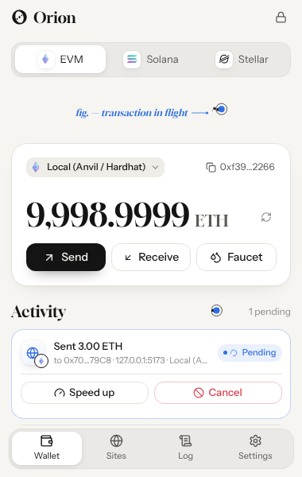
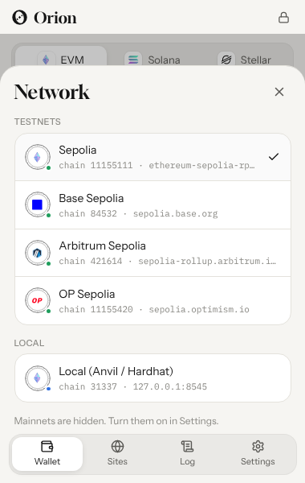
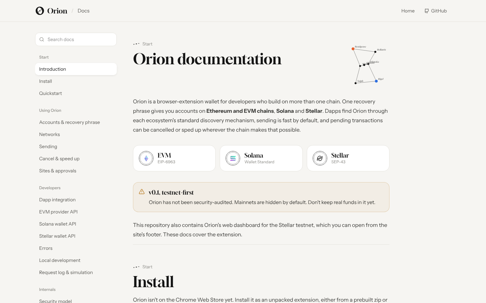

<div align="center">

<picture>
  <source media="(prefers-color-scheme: dark)" srcset="public/orion-logo-light.svg">
  
</picture>

### The wallet for every chain you build on.

A browser-extension wallet for developers: one recovery phrase for **Ethereum & EVM chains**, **Solana** and **Stellar**,<br>
dapp sync on every chain, fast sends, and real cancel / speed-up where the chain allows it.

[Documentation](#documentation) · [Install](#install) · [Integrate](#integrate-with-your-dapp) · [How it works](#how-it-works) · [Contributing](#development)

<br>


</div>

---

> [!WARNING]
> **v0.1, testnet-first.** Orion has not been security-audited. Mainnets are hidden by default. Please don't keep real funds in it yet.

## Why Orion

Building across chains usually means juggling MetaMask for EVM, Phantom for Solana and Freighter for Stellar, three sets of testnet faucets, and no way to undo a stuck transaction. Orion puts all of that in one extension designed around how developers actually work:

- **One phrase, three families.** Standard derivation paths, so importing your phrase shows the same accounts as MetaMask, Phantom and Freighter.
- **Speaks every dapp's language.** EIP-6963 for EVM, the Wallet Standard for Solana, and SEP-43 for Stellar. Orion sits alongside your other wallets instead of fighting them.
- **Fast by default, reversible where possible.** Priority fees tuned per chain, real cancel and speed-up on EVM and Stellar, and an honest expiry countdown on Solana.
- **Built for testnets and local nodes.** Anvil / Hardhat, solana-test-validator and Stellar Quickstart are one click away, with faucets built in.
- **Tells you the truth.** Transactions are simulated before you sign, every dapp request is logged, and unreachable nodes are reported instead of hidden behind fake balances.

<div align="center">
&nbsp;&nbsp;
&nbsp;&nbsp;

<br>
<sub>Wallet on a local Hardhat chain · a pending dapp payment with Speed up and Cancel · the cancel wins, the original is replaced</sub>
</div>

## Features

### Chains

| | EVM | Solana | Stellar |
|---|---|---|---|
| **Networks** | Sepolia, Base Sepolia, Arbitrum Sepolia, OP Sepolia, Anvil / Hardhat, custom chains · Ethereum & Base (opt-in) | Devnet, Testnet, solana-test-validator · Mainnet (opt-in) | Testnet, Quickstart · Public (opt-in) |
| **Dapp standard** | EIP-1193 via EIP-6963 | Wallet Standard | SEP-43, SEP-53 messages |
| **Derivation** | `m/44'/60'/0'/0/0` (BIP-32) | `m/44'/501'/0'/0'` (SLIP-10) | `m/44'/148'/0'` (SEP-5) |
| **Faucet** | `anvil_setBalance` / `hardhat_setBalance`, testnet links | Airdrop | Friendbot |

### Fast sends, cancel and speed-up

| Chain | Fast send | Speed up | Cancel |
|---|---|---|---|
| **EVM** | 2× suggested priority fee | Same nonce, fees +12.5% or current fast fee | 0-value self-transfer on the same nonce |
| **Stellar** | p90 fee, 30-second time bound | Fee-bump transaction at 10× (stellar-core's replace-by-fee rule) | Same-sequence no-op `bumpSequence` at 10× |
| **Solana** | p75 priority fee, rebroadcast every 2.5 s | Not safely possible | Not possible: Orion shows the blockhash-expiry countdown, after which it can never land |

### Developer tools

- **Request log**: every call a dapp made, with params, result, errors and timing.
- **Simulation before signing**: EVM transactions run through `eth_estimateGas`. Reverts, unlimited ERC-20 approvals and `setApprovalForAll` are flagged in the approval window.
- **Custom chains**: dapps can add and switch EVM chains with `wallet_addEthereumChain` / `wallet_switchEthereumChain`.
- **Clear approvals**: every request shows the site, network and a plain-language summary of what you're signing.

<div align="center">
&nbsp;&nbsp;
&nbsp;&nbsp;

</div>

## Install

Orion isn't on the Chrome Web Store yet; load it as an unpacked extension.

```bash
git clone https://github.com/arg0506/Orion
cd Orion/extension
npm install
npm run build          # outputs extension/.output/chrome-mv3
```

1. Open `chrome://extensions` and switch on **Developer mode**.
2. Click **Load unpacked** and choose `extension/.output/chrome-mv3`.
3. Pin Orion, then create a wallet or import a recovery phrase.

Works in Chromium browsers (Chrome, Brave, Edge, Arc). For live reload while developing, run `npm run dev`.

## Integrate with your dapp

**EVM**: any EIP-6963-aware library (wagmi v2, RainbowKit, Reown AppKit, ConnectKit) lists Orion automatically. Directly:

```js
window.addEventListener('eip6963:announceProvider', (e) => {
  if (e.detail.info.rdns === 'app.orion.wallet') {
    e.detail.provider.request({ method: 'eth_requestAccounts' });
  }
});
window.dispatchEvent(new Event('eip6963:requestProvider'));
```

**Solana**: nothing to install. Orion registers with the Wallet Standard and appears in `@solana/wallet-adapter` as "Orion".

**Stellar**: a SEP-43 interface at `window.orion.stellar` (errors are returned, not thrown):

```js
const { address } = await window.orion.stellar.getAddress();
const { signedTxXdr } = await window.orion.stellar.signTransaction(xdr, { networkPassphrase });
```

The full provider reference (every supported method, event and error code) is in the [documentation](#documentation).

## Documentation

The website includes a complete documentation page at **`/#/docs`**, covering:

- Install and quickstart
- Accounts, networks, sending, cancel & speed-up, approvals
- Dapp integration for each chain, with copy-paste examples
- Full EVM, Solana and Stellar provider API reference and error codes
- Local development with Anvil / Hardhat, solana-test-validator and Stellar Quickstart
- Security model, architecture, testing, troubleshooting and roadmap

Run the site locally with `npm install && npm run dev` from the repository root, then open `http://localhost:3000/#/docs`.

<div align="center">

</div>

## How it works

```
Orion/
├─ extension/                  the wallet (WXT + React, Manifest V3)
│  ├─ entrypoints/
│  │  ├─ background.ts         service worker: routes popup + dapp messages, auto-lock
│  │  ├─ inpage.content.ts     page world: EVM, Solana and Stellar providers
│  │  ├─ bridge.content.ts     isolated world: relays page <-> background
│  │  ├─ popup/                the wallet UI
│  │  └─ approval/             the approval window
│  ├─ src/lib/
│  │  ├─ keyring/              BIP-39 / BIP-32 / SLIP-10 derivation, encrypted vault
│  │  ├─ chains/               evm.ts · solana.ts · stellar.ts adapters
│  │  ├─ dapp/                 per-chain request handlers + permissions
│  │  └─ tracker.ts            pending-tx polling, Solana rebroadcast, replacement races
│  ├─ src/inpage/              the providers dapps talk to
│  ├─ src/ui/                  screens + the engraved illustration system
│  └─ e2e/                     end-to-end suite (real Chrome + test dapp)
├─ src/                        the website: landing page, docs, Stellar web dashboard
└─ docs/images/                screenshots used in this README
```

A dapp request travels **page → bridge content script → background service worker**. The background takes the requesting origin from the browser (never from the page), checks the site's permission, opens an approval window when needed, signs with the right chain adapter, logs the call, and replies. Account and network changes are pushed back to every tab, filtered by each site's permissions.

### Security model

- The recovery phrase is encrypted with **PBKDF2-SHA256 (600,000 iterations) → AES-256-GCM** and stored in `chrome.storage.local`.
- While unlocked, it lives only in `chrome.storage.session` (memory, never on disk) and is cleared on lock, auto-lock (default 30 min) or browser close.
- Keys never leave the background service worker; pages only receive addresses and signatures.
- Every connection, signature and transaction needs explicit approval in an extension-owned window.

### Design

Orion's interface is ink on paper: Gloock serif headlines, a halftone stippled planet, and illustrations in the style of an old star atlas (stippled celestial bodies, engraved medallions for each chain, an astrolabe, and small italic annotations such as *"fig. — node unreachable"*). The illustrations are generated in code, so each stippled body prints itself dot by dot. Animation respects `prefers-reduced-motion`.

Chain and network marks (Ethereum, Base, Arbitrum, Optimism, Sepolia, Solana, Stellar) come unaltered from [`@web3icons/react`](https://github.com/0xa3k5/web3icons) (MIT) and belong to their respective projects.

## Development

```bash
# Extension
cd extension
npm install
npm run dev            # live-reloading build
npm run typecheck
npm test               # unit + integration tests

# Website (landing page, docs, Stellar web dashboard)
cd ..
npm install
npm run dev            # http://localhost:3000
npm run build
```

### Tests

| Suite | What it proves |
|---|---|
| **Key derivation** | Matches the official SLIP-10 and SEP-5 test vectors and Hardhat's default accounts. |
| **Vault** | Round-trips with the right password, rejects the wrong one, fresh salt and IV every time. |
| **EVM integration** | Against a real local node with automining off: speed-up and cancel replace the pending transaction, and the original never lands. |
| **Solana & Stellar** | Priority-fee transfers, fee-bump speed-up, same-sequence cancel and SEP-53 signing, offline. |
| **End to end** | Loads the built extension in Chrome, onboards through the UI, and drives a test dapp across all three chains, including cancelling a pending payment from the popup (18 checks). |

```bash
cd extension
npx hardhat node            # or: anvil   (in another terminal)
REQUIRE_LOCAL_NODE=1 npm test
python3 e2e/e2e.py          # needs Python Playwright and a Chromium that allows --load-extension
```

## Roadmap

- Multiple accounts per chain and hardware wallets
- Token balances (ERC-20, SPL, Stellar assets)
- Soroban `signAuthEntry` and WalletConnect pairing
- NEAR and more chains
- Firefox build and a Chrome Web Store release
- An independent security audit

## Stellar web dashboard

This repository also contains Orion's original web dashboard for the Stellar testnet (`/#/terminal`): connect Freighter, fund an account with Friendbot, send XLM, and watch addresses. It shares the website's design and is a handy companion when you're testing Stellar flows without the extension.

---

<div align="center">
<sub>Built by <a href="https://github.com/arg0506">Arpan Roy</a> · Look up, then ship.</sub>
</div>
